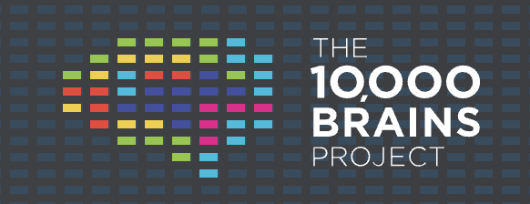

# path-nd-uploader

Checks that a pathology slide file is whole (not cut short, not zero-filled)
and that its metadata matches the
[Path-ND CDE schema](https://github.com/The-10-000-Brains-Project/pathnd-cdes),
then uploads it to Google Cloud Storage. Nothing uploads unless both pass. It
can also scan a bucket that was already uploaded.

## Setup

Requires Python 3.10+ and the `gcloud` CLI.

```bash
python3 -m venv .venv
source .venv/bin/activate      # Windows: .venv\Scripts\activate
pip install .

gcloud auth login
gcloud auth application-default login
```

Both logins are needed. Different parts of the tool use different
credentials. Re-run `source .venv/bin/activate` in each new terminal.

## Quick start

Check one slide:

```console
$ path-nd-uploader validate slide001.svs
[PASS] slide001.svs
```

A slide that was cut short:

```console
$ path-nd-uploader validate cut.svs
[FAIL] cut.svs
    [error] structural_completeness: no readable TIFF pages found — the file's directory structure appears to be corrupted
```

A slide with part of it overwritten by zeros:

```console
$ path-nd-uploader validate zeroed.svs
[FAIL] zeroed.svs
    [error] zero_filled_data: 1 zero-filled region(s) (12,288 bytes in all) inside compressed image data — first at byte 970,752 (12,288 bytes); part of the file was zero-filled (compressed image data is never all zeros)
```

A multi-file slide with a missing piece:

```console
$ path-nd-uploader validate CMU-1-Saved-1_16.mrxs
[FAIL] CMU-1-Saved-1_16.mrxs
    [error] bundle_completeness: multi-file slide is missing: 'CMU-1-Saved-1_16/Data0003.dat'
```

A file type that isn't supported:

```console
$ path-nd-uploader validate scan.czi
[FAIL] scan.czi
    [error] extension: '.czi' (Zeiss) is a recognized pathology format but not yet supported (supported: ['.bif', '.mrxs', '.ndpi', '.scn', '.svs', '.svslide', '.tif', '.tiff', '.vms', '.vmu'])
```

The exit code is 0 on pass and 1 on fail, so it works in scripts.

## Commands

```bash
# Validate one slide
path-nd-uploader validate slide001.svs

# Validate one slide against its metadata
path-nd-uploader validate slide001.svs --metadata slide001.csv

# Validate and upload one slide
path-nd-uploader upload slide001.svs --metadata slide001.csv --bucket my-bucket

# A folder of slides, integrity check only (no metadata, no upload)
path-nd-uploader batch ./incoming

# A spreadsheet of slides: validate, then upload the ones that pass
path-nd-uploader batch metadata.csv --bucket my-bucket --report run_report.jsonl

# Scan slides already in a bucket
path-nd-uploader audit my-bucket --prefix Collection_PART/ --report audit_report.jsonl

# Copy slides from one bucket to another (checked first, copied server-side)
path-nd-uploader transfer source-bucket dest-bucket --prefix Collection_PART/
```

Running a folder:

```console
$ path-nd-uploader batch ./incoming
[FAIL] incoming/bad.svs
     structural_completeness: no readable TIFF pages found — ...
[PASS] incoming/ok.svs
  Validating ━━━━━━━━━━━━━━━━━━━━━━━━━━━━━━━━━━━━━━━━ 2/2

1/2 passed
```

`--report` writes one JSON line per slide as it finishes, so the file is
still there if the run is interrupted.

If you see `[COULD NOT VERIFY]`, a network error interrupted the check. It is
not a finding about the file. Run it again.

## Fast and deep checks

There are two levels.

|  | Fast | Deep |
|---|---|---|
| Reads | A few small pieces of the file | The whole file |
| Needs the file on local disk | No (works on bucket objects) | Yes |
| Needs OpenSlide | No | Yes |
| Default for | `audit`, `transfer` | `validate`, `upload`, `batch` |
| Turn on / off | `--deep` | `--no-deep` |

```bash
path-nd-uploader validate slide001.svs --no-deep   # fast only
path-nd-uploader audit my-bucket --deep            # downloads each object that passes the fast scan
```

### What fast checks do

1. **Header.** The file starts with a valid TIFF header (`.svslide` is checked
   for a SQLite header).
2. **Zero tail.** The end of the file is not a long run of zeros. This is what
   an interrupted upload looks like, including a file padded with zeros back
   to its original size.
3. **Page directory.** The list of image pages in the file can be read, no
   page is empty, no page points past the end of the file, and the largest
   page is at least 512×512.
4. **Tile sampling.** About 64 small windows of image data are read. If any is
   entirely zeros, the file fails.
5. **Multi-file slides** (`.mrxs`, `.vms`, `.vmu`). Every file the slide refers
   to exists.

Fast checks add roughly 150 small range reads per file.

### What deep checks add

1. **Zero-fill scan.** Every byte of compressed image data is checked.
   Compressed data never contains two adjacent all-zero 4 KiB blocks, so any
   such run means part of the file was zeroed. This finds zeroed regions of
   about 12 KiB and up. A 6.9 GB slide takes about 3 seconds on a local SSD.
2. **OpenSlide read.** The slide is opened and a 3×3 grid of small regions is
   read from every pyramid level.

Same file, both modes. A 16 KiB zeroed region, small enough that sampling
usually misses it:

```console
$ path-nd-uploader validate small.svs --no-deep
[PASS] small.svs

$ path-nd-uploader validate small.svs
[FAIL] small.svs
    [error] zero_filled_data: 1 zero-filled region(s) (12,288 bytes in all) inside compressed image data — first at byte 970,752 (12,288 bytes); ...
```

If you need a guarantee, use deep.

## Supported formats

| Extension | Format | Notes |
|---|---|---|
| `.svs` | Aperio | |
| `.ndpi` | Hamamatsu | Files over 4 GiB work |
| `.scn` | Leica | |
| `.bif` | Ventana | |
| `.tif`, `.tiff` | Generic and Philips TIFF | |
| `.mrxs` | 3DHISTECH MIRAX | Needs its data folder next to it |
| `.vms`, `.vmu` | Hamamatsu | Needs the image files it lists |
| `.svslide` | Sakura | |

These are the formats OpenSlide can open. Formats it can't open (`.czi`,
`.vsi`, `.qptiff`, `.isyntax`, `.dcm`, `.zarr`, `.jp2`, `.dzi`) are rejected
with "recognized but not yet supported" instead of being half-checked.

## Known limits

- **MIRAX data files.** `Data*.dat` files are checked for presence only. A
  truncated or zeroed data file is not detected. Good MIRAX data files really
  do end in long runs of zeros, so a tail check would flag good slides.
- **Corruption that isn't zeros.** Flipped bits or random garbage in tile data
  are caught only if they break the page directory or an OpenSlide read. The
  tool does not decode every tile.
- **One missing byte.** On several formats, a file missing only its last byte
  passes, because nothing in the file points at that byte.
- **Fast mode samples.** A zeroed run in the middle of a file is found only if
  a sampled window lands in it. Larger runs are more likely to be hit. In
  tests on 10 real slides, 8 MiB zeroed runs were caught by fast mode in
  0 to 4 of 5 positions depending on the slide. Deep caught all of them.
- **Some valid slides can't be opened by OpenSlide 4.0.x.** These are Ventana
  scanners that write joint direction `LEFT`, and Leica SCNs with several
  regions at different resolutions. The deep OpenSlide step is reported as a
  `warning` for these, not a failure. Only the fast checks and the zero-fill
  scan protect those files.
- **Bucket audits of multi-file slides** look for the other files by name,
  under the same prefix as the `.mrxs`/`.vms`/`.vmu` object.
- **Bucket access is tested with mocks only.** The `audit` and `transfer`
  code has not been run against a real bucket.

What this tool does not check: focus, stain, artifacts, tissue coverage, or
any other image quality question. For that, use something like HistoQC. This
tool answers one question: is the file whole?

## Metadata

Most brain banks already have a spreadsheet with one row per slide. Point
`batch` at it (CSV, JSON, or xlsx):

```csv
participant_id,brain_bank_id,study,slide_paths,stain_type
P-00231,BB-4471,Path-ND,slide001.svs,HE
```

`participant_id`, `brain_bank_id`, `study`, `slide_paths` and `stain_type` are
required. `slide_paths` links each row to its file. To see every field:

```bash
path-nd-uploader schema show
```

If your spreadsheet uses different column names, map them with a profile:

```bash
path-nd-uploader batch export.xlsx --profile bdr --bucket my-bucket
```

Run `path-nd-uploader batch --help` for the list of profiles.

## Development

```bash
pip install -e ".[dev]"
pytest
```

The tests include two small real slides (an Aperio `.svs` and a MIRAX
bundle) in `tests/fixtures/real/`. See the README there for their source and
license.
